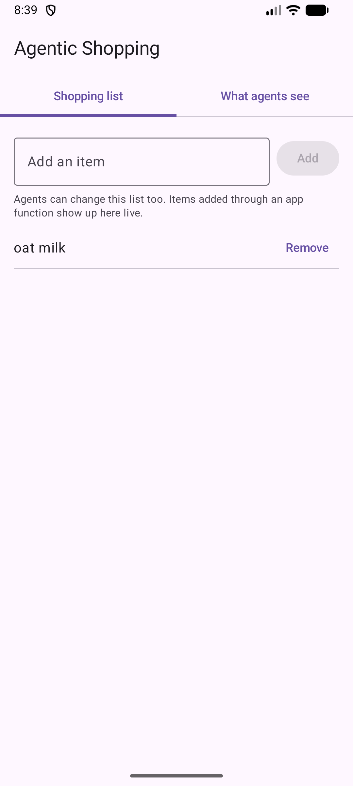
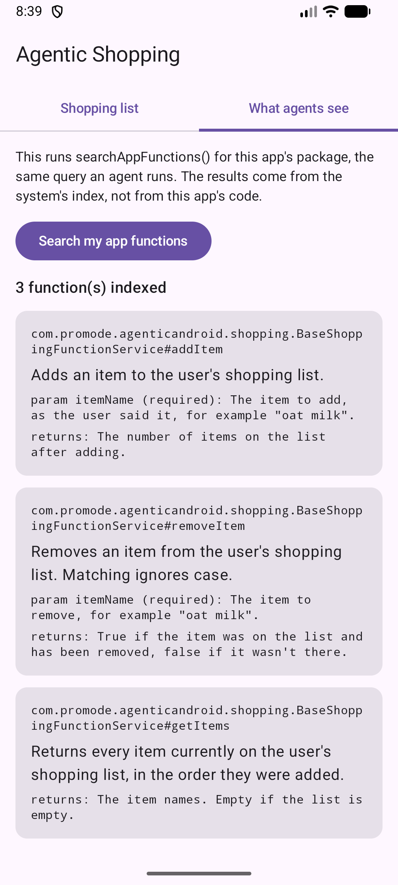
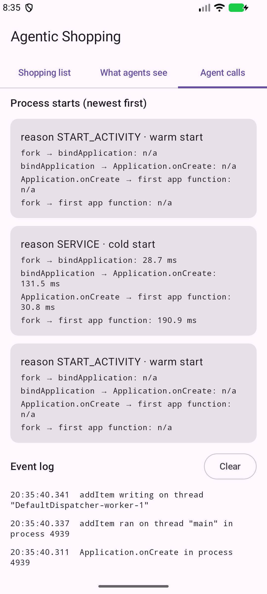

# Agentic Android samples

Working code for **Agentic Android**, a weekly series on how AI agents call, read, run inside and build Android apps, traced through the real platform source. Each episode adds to this repo, and each episode has a git tag (`e01`, `e02`, …) so the code linked from an article never changes under it.

The sample is a small shopping-list app. Its list can be changed from the UI or by an agent through [AppFunctions](https://developer.android.com/jetpack/androidx/releases/appfunctions), Android's on-device way for apps to expose functions to agents.

## Episode 1: how agents discover your app's functions

Article: *Your Android App Is Now an MCP Server* (link added on publication).

What this tag shows:

| File | What it demonstrates |
|---|---|
| [`BaseShoppingFunctionService.kt`](app/src/main/kotlin/com/promode/agenticandroid/shopping/BaseShoppingFunctionService.kt) | Three functions declared with `@AppFunctionDeclaration(isDescribedByKDoc = true)` inside an `@AppFunctionServiceEntryPoint` service. The KDoc is what agents read. |
| [`AndroidManifest.xml`](app/src/main/AndroidManifest.xml) | The service declaration the system indexer needs: the `BIND_APP_FUNCTION_SERVICE` permission, the AppFunctionService intent filter, and the `android.app.appfunctions.v2` property pointing at the generated XML. |
| [`AgentViewScreen.kt`](app/src/main/kotlin/com/promode/agenticandroid/shopping/AgentViewScreen.kt) | Runs `searchAppFunctions()` on the app's own package (no permission needed) and shows what the system indexed. |
| [`ShoppingList.kt`](app/src/main/kotlin/com/promode/agenticandroid/shopping/ShoppingList.kt) | The shared data. Changes made by an agent show up in the UI live. |

<p>
  
  
</p>

At build time the AppFunctions KSP compiler generates `ShoppingFunctionService` and `assets/shopping_functions.xml`. At install time, AppSearch's apps indexer in system_server reads that XML out of the APK, and agents search the resulting index. Your app's code doesn't run for any of that.

## Episode 2: what happens when an agent calls your app

Article: *What Happens When an Agent Calls Your App* (link added on publication).

What this tag adds:

| File | What it demonstrates |
|---|---|
| [`ShoppingApplication.kt`](app/src/main/kotlin/com/promode/agenticandroid/shopping/ShoppingApplication.kt) | `Application.onCreate` runs on every process start, including starts an agent causes. A switch simulates 800 ms of SDK-style init. |
| [`BaseShoppingFunctionService.kt`](app/src/main/kotlin/com/promode/agenticandroid/shopping/BaseShoppingFunctionService.kt) | Each function logs its thread and stamps its first call into `ApplicationStartInfo`. `addItem` is a `suspend` function that moves its write off the main thread. |
| [`AgentCallsScreen.kt`](app/src/main/kotlin/com/promode/agenticandroid/shopping/AgentCallsScreen.kt) | Reads `ActivityManager.getHistoricalProcessStartReasons()`: why each process started (an agent call shows `SERVICE`, cold) and the fork, bindApplication and Application.onCreate timestamps. |
| [`tools/agent_call_timing.py`](tools/agent_call_timing.py) | Times agent-style calls cold, warm, and cold with heavy init. |

<p>
  
</p>

Reproduce it:

```
adb shell am force-stop com.promode.agenticandroid.shopping
adb shell cmd app_function execute-app-function \
  --package com.promode.agenticandroid.shopping \
  --function "com.promode.agenticandroid.shopping.BaseShoppingFunctionService#addItem" \
  --parameters "'{\"itemName\":\"coffee\"}'"
adb shell dumpsys activity start-info com.promode.agenticandroid.shopping
```

The newest record reads `reason=SERVICE startType=COLD` with
`intent=Intent { act=android.app.appfunctions.AppFunctionService … }`: the call started the process.

Measured with `tools/agent_call_timing.py` on an Android 17 emulator (API 37), 5 runs each, host-side
around the adb command (adb overhead included):

| Scenario | Median | Range |
|---|---|---|
| Cold: process not running | 244.5 ms | 222 to 252 ms |
| Warm: process already running | 32.3 ms | 26 to 35 ms |
| Cold with 800 ms in `Application.onCreate` | 1074.0 ms | 1059 to 1082 ms |

## Requirements

- Android Studio with a JDK 17+ (the bundled JBR works).
- A device or emulator running **Android 17 (API 37)** for the `adb` commands below. The app installs on Android 16 (API 36), but the `cmd app_function` shell command first appears in Android 17.

Pinned toolchain (see [`gradle/libs.versions.toml`](gradle/libs.versions.toml)): AGP 9.4.0 with built-in Kotlin, Kotlin 2.3.10, KSP 2.3.10, `androidx.appfunctions` 1.0.0-beta01, compileSdk/targetSdk 37, minSdk 36.

## Build and run

```
./gradlew :app:installDebug
```

Then see what the system indexed:

```
adb shell cmd app_function list-app-functions
```

Look for the three function IDs ending in `#addItem`, `#removeItem` and `#getItems`. If they're missing, check the service's `android:permission` first. Trimmed output from an Android 17 emulator (API 37):

```
adb shell cmd app_function list-app-functions --package com.promode.agenticandroid.shopping
{
  "com.promode.agenticandroid.shopping": [
    {
      "AppFunctionStaticMetadata-com.promode.agenticandroid.shopping": {
        "serviceName": [
          "com.promode.agenticandroid.shopping.ShoppingFunctionService"
        ],
        "description": [
          "Adds an item to the user's shopping list."
        ],
        "response": [
          {
        …
        "functionId": [
          "com.promode.agenticandroid.shopping.BaseShoppingFunctionService#addItem"
        ],
        …
```

Call a function the way an agent would (this works even when the app isn't running):

```
adb shell cmd app_function execute-app-function \
  --package com.promode.agenticandroid.shopping \
  --function "com.promode.agenticandroid.shopping.BaseShoppingFunctionService#addItem" \
  --parameters "'{\"itemName\":\"oat milk\"}'"
{
  "androidAppfunctionsReturnValue": [
    1
  ]
}
```

Open the app and "oat milk" is on the list.

To see the silent failure the article describes, remove the `android:permission` attribute from the service in `AndroidManifest.xml`, reinstall and list again. On an Android 17 emulator the build succeeds and the list comes back empty: the indexer skips the service and nothing reports an error.

Inspect the generated XML inside the APK:

```
unzip -p app/build/outputs/apk/debug/app-debug.apk assets/shopping_functions.xml
```

## Adding AppFunctions to your own app

1. Add `androidx.appfunctions:appfunctions` and, through KSP, `androidx.appfunctions:appfunctions-compiler` (same version).
2. Create an abstract class extending `androidx.appfunctions.AppFunctionService`, annotate it with `@AppFunctionServiceEntryPoint(serviceName = ..., appFunctionXmlFileName = ...)`, and put your `@AppFunctionDeclaration` functions inside it. Since 1.0.0-alpha13 the annotation is `@AppFunctionDeclaration`; older samples that use `@AppFunction` won't compile.
3. Set `isDescribedByKDoc = true` and write KDoc for a reader who sees nothing else: a one-line summary, `@param` for each parameter and `@return`.
4. Declare the generated service in your manifest exactly as this sample does.
5. Install on Android 17 and confirm your IDs appear in `adb shell cmd app_function list-app-functions`.

## Status

AppFunctions is a beta/experimental preview feature in the platform and `1.0.0-beta01` in Jetpack. APIs may change between releases; each episode tag records the versions it was verified against.

## License

[Apache License 2.0](LICENSE).
